# CPA Business Logic

**Database:** `DBAFF12B-Affiliate_12B`  
**Module Scope:** CPA (Cost Per Action) lifecycle – player qualification, monitoring, billing, payment, and adjustment.

---

## Overview

The CPA model rewards affiliates when referred players satisfy staged behavioural thresholds (first deposit, cumulative deposits, turnover, bet tickets, redeposit) within time windows. Each player traverses discrete lifecycle phases (Active → Holding → Monitoring/Redeposit → Payment Approval) producing a single CPA payout (or exclusion) per deal schedule. The system is versioned: deal (commission group) settings – including CPA tier thresholds and product mappings – are time-sliced with FromDate/ToDate ranges enabling historical recalculation and auditable evolution. A daily orchestrator job executes phase-specific stored procedures, mutating player CPA state, generating payment schedules, and finalizing transactions.

---

## Core Entities

### Player & Affiliate

* `MemberInfo`: Player master; links to `AffInfo` via `AffId`; holds registration, first deposit metrics, tags (for abnormal detection) and removal flag.
* `AffInfo`: Affiliate master; current commission group (`GroupId`) drives applicable CPA settings; historical assignment kept in `AffGroupHistory`.

### CPA Lifecycle State

* `MemberCPA`: One row per player per deal (group); holds qualification dates, cumulative financial KPIs, status code (0–6), final payout, redeposit flags, quota outcome.
* `MemberCPATier`: Tier-granular turnover and CPAAmount contributions (roll up to `MemberCPA`).
* `MemberCPAProduct`: Product-level turnover and bet tickets supporting tier evaluation and analytics.
* `MemberCPA_EOL`: Archived end-of-life snapshots for expired/unqualified players (audit trail of failed Active window).

### Deal & Versioned Settings

* `CommGroup`: Current commission / CPA group definition (hybrid attributes, durations, quota, redeposit config, schedule binding).
* `CommGroupHistory`: Monthly snapshot of (primarily revenue share) fields for reporting consistency.
* `CPAGroupSetting`: Versioned CPA group parameters (ActiveDays, HoldingDays, Quota, RedepositDays/Rate, country whitelist, ScheduleId). Open row has `ToDate=9999-12-31` (or NULL where schema uses NULL).
* `CPATierSetting`: Versioned multi-tier thresholds per product category (`GroupProductId`): ranges over Min/Max FDM, TotalDeposit, Turnover; maps to fixed `CPAAmount`.
* `CPAProductSetting`: Versioned mapping of groups to product categories/products used to validate turnover-driven tier conditions.
* `DealBillingSchedule`: Next billing date pointer per group/schedule; advanced post-approval.
* `Schedule`: Interval semantics (Day / Week / Month + value) for billing cycles.

### Payment & Reporting

* `rptAffiliateCPA`: Aggregated payment schedule row per affiliate/group cycle (Eligible counts, Redeposit progress, Estimated / Approved / Adjusted amounts, Status).
* `AffTrans`: Financial transaction header for CPA payouts (and manual adjustments – TransType mapping external).
* `AffTransSubDetail`: Sub-affiliate breakdown (not directly mutated by CPA core steps; used in composite reporting).
* `rptMemberDaily`: High-volume daily player/product financial metrics; source for cumulative turnover/deposit/FDM during qualification & monitoring.

### Lookup / Dimension

* `GroupType`: Defines deal type (1 Revenue Share, 3 CPA, 4 Hybrid). Drives whether CPA logic applies.
* `Exchange`, `TpExchange`: Currency and external exchange mapping for rate normalization.
* `TransType`: Codes for `AffTrans` classification (CPA settlement, adjustment, payment, etc.).
* External dependency: `bodb_12B.dbo.Tag` (IsAbnormal flag) referenced in abnormal detection.

### Relationships (Logical – FKs mostly implicit)

* `AffInfo.GroupId` → active `CommGroup.GroupId` (versioned logically via `CPAGroupSetting` rows selected by date).
* `MemberCPA.(AffId,CustId,GroupId)` ↔ `AffInfo.AffId`, `MemberInfo.CustId`, `CommGroup.GroupId`.
* `MemberCPATier.MemberCPA_ID` & `MemberCPAProduct.MemberCPA_ID` → parent CPA lifecycle row.
* Version lineage: `CPAGroupSetting` / `CPATierSetting` / `CPAProductSetting` use (GroupId + FromDate/ToDate) to ensure non-overlapping effective ranges.
* Payment: `rptAffiliateCPA.(AffId,GroupId)` summarises qualified `MemberCPA` (StatusId=2) per billing window; `AffTrans.RefId` links back to `MemberCPA.RefId` when settled.

---

## Process Flow

Daily (or scheduled) job executes ordered SPs, each idempotent or safe to re-run for the same @CPADate.

```mermaid
flowchart LR
    RST[Task_Aff_CPAResetIsAbnormal\nReset prior abnormal if tags cleared] --> ACT[Task_Aff_CPAActivePeriod\nEvaluate Active window & tiers]
    ACT --> HOLD[Task_Aff_CPAHoldingPeriod\nHolding bet tickets]
    HOLD --> ABN[Task_Aff_CPAMarkIsAbnormal\nFlag abnormal via TagList]
    ABN --> RED[Task_Aff_CPACheckRedeposit\nMonitor redeposit window]
    RED --> SCHED[Task_Aff_CPAPaymentSchedule\nBuild/Update payment schedule rows]
    SCHED --> APPROVE[Task_Aff_CPAApprovalPeriod\nQuota + payout AffTrans]
    APPROVE --> ADV[Task_Aff_UpdateDealSchedule\nAdvance billing NextBillingDate]
```

### Phase Semantics

1. Reset Abnormal: Return previously abnormal players (StatusId=4) to Pending (0) if tags no longer abnormal.
2. Active Period: Determine qualifying players; assign tiers/products; archive non-qualifying expired rows; update `MemberCPA` metrics.
3. Holding Period: Evaluate bet ticket requirement; transition StatusId to Eligible (2) or Active Completed (1) / failure.
4. Mark Abnormal: Tag-based exclusion; move StatusId to 4.
5. Redeposit Check (Monitoring): Validate cumulative deposits beyond first deposit baseline within redeposit window; set `IsRedeposit` and influence schedule status.
6. Payment Schedule: Insert/update `rptAffiliateCPA` per billing groups; classify Monitoring / Qualified / Not Qualified / Empty.
7. Approval Period: Enforce quota; create CPA payout `AffTrans`; set StatusId=3 (Paid); quota exceeded → StatusId=5.
8. Deal Schedule Advance: Move `DealBillingSchedule.NextBillingDate` forward based on interval rules.

---

## Rules and Conditions

### Status Codes (`MemberCPA.StatusId`)

| Code | Meaning |
|------|---------|
| 0 | Pending / Active phase in progress |
| 1 | Active Completed (Holding pending or failed) |
| 2 | Eligible (Holding met; awaiting payment / redeposit cycle) |
| 3 | Settled / Paid |
| 4 | Abnormal (excluded – Tag-based) |
| 5 | Quota Exceeded (not paid) |
| 6 | Redeposit Failed (post monitoring) |

### Tier Qualification Logic

* Evaluate per `CPATierSetting` row matching product category; player metrics (FDM, TotalDeposit, Turnover) must satisfy Min/Max ranges.
* Highest tier selected by removing lower-tier rows (DELETE-lower strategy after initial matches).
* Negative infinity sentinel values: Min values can start at 0 or -∞ for revenue tiers (pattern reused conceptually for CPA ranges; extreme caps use large positive constants e.g. 100000000000).
* Product turnover conditions require corresponding product mapping rows in `CPAProductSetting`.

### Redeposit

* Window: Between Holding qualification and `ExpiredRedepositDate` derived from RedepositDays.
* Condition: Cumulative deposits (excluding baseline FDM) > FDM triggers `IsRedeposit=1`.
* Status influence: Payment schedule classification (Qualified vs Monitoring vs Not Qualified).

### Quota Enforcement

* During Approval: Order eligible members (StatusId=2) by deterministic ROW_NUMBER; excess beyond `Quota` → StatusId=5 (excluded from payout).

### Abnormal Detection

* Tags in `MemberInfo.TagList` referencing external Tag table where `IsAbnormal=1` set cause transition to StatusId=4.
* Reset step reverts those whose tags are now clean back to Pending for recalculation.

### Expiry & Archival

* Players failing to meet Active criteria within ActiveDays (and optionally Holding prerequisites) are archived into `MemberCPA_EOL`.

### Idempotency Safeguards

* Each phase recalculates using date-scoped criteria; existing settled rows (StatusId=3) skipped; quota marking stable; schedule rows updated not duplicated.

---

## Data Flow

| Phase | Inputs | Core Aggregations | Outputs / Writes |
|-------|--------|-------------------|------------------|
| Reset Abnormal | MemberCPA, MemberInfo.TagList, CPA settings | Tag existence filter | Update MemberCPA.StatusId (4→0) |
| Active Period | MemberInfo, `rptMemberDaily` (historical window), CPAGroupSetting, CPATierSetting, CPAProductSetting | Summarize deposits, turnover, bets; tier matching | Upsert MemberCPA; rebuild MemberCPATier/Product; archive EOL |
| Holding Period | MemberCPA (Active qualified), bet ticket sources (implicit), CPAGroupSetting | Count bet tickets vs requirement | Update Holding* fields; Status transitions |
| Mark Abnormal | MemberCPA + TagList | STRING_SPLIT tag parsing | StatusId=4; Description set |
| Redeposit Check | MemberCPA Eligible set + rptMemberDaily | Sum deposits between FirstDepositDate and monitoring boundary | Set IsRedeposit; UpdatedDate |
| Payment Schedule | MemberCPA (Eligible & redeposit state), DealBillingSchedule, CPAGroupSetting | Count eligible, redeposit progress | Insert/Update rptAffiliateCPA rows |
| Approval Period | rptAffiliateCPA Qualified rows, MemberCPA Eligible, CPAGroupSetting quotas | Aggregate CPAAmount per affiliate; quota ordering | AffTrans inserts; MemberCPA StatusId & RefId updates |
| Schedule Advance | DealBillingSchedule | Interval arithmetic (EOMONTH + offset) | Update NextBillingDate |

### Metric Sources

* Historical KPIs: `rptMemberDaily` (partition boundary at defined commission date for other reporting; CPA steps rely on daily aggregates pre/post Active window).
* Currency normalization: Via `Aff_f_ExchangeRate_Sel` (applied when converting FDM or deposit amounts for tier comparisons across multi-currency players).

### Logging & Audit

* Deal operations (assignment & mutation) logged via `Aff_UserLog_RunSP_Detail_WriteLog` with JSON segments (di, ci, ct, ri, rt).
* CPA approval creates financial audit trail in `AffTrans`; `MemberCPA.RefId` links settlement.

---

## Dependencies

### Internal Stored Procedures (Execution Order)

1. `Task_Aff_CPAResetIsAbnormal`
2. `Task_Aff_CPAActivePeriod`
3. `Task_Aff_CPAHoldingPeriod`
4. `Task_Aff_CPAMarkIsAbnormal`
5. `Task_Aff_CPACheckRedeposit`
6. `Task_Aff_CPAPaymentSchedule`
7. `Task_Aff_CPAApprovalPeriod`
8. `Task_Aff_UpdateDealSchedule`

All orchestrated by `Task_Aff_CPACalculation_Job` (@Step parameter enables partial re-run).

### Functions & External Objects

* `Aff_f_ExchangeRate_Sel` – currency conversion for FDM / deposit comparison & payout normalization.
* `Aff_f_GetMinReportDate` – earliest month boundary used in statement/reporting (ancillary to CPA schedule context).
* `Aff_f_AffGroupInfo_Sel` – resolves affiliate group type per month (affects inclusion of CPA vs revenue components in financial statements).
* `Aff_Commission_UnCalc` – computes uncalculated (future) commission projections (used in reporting, not core CPA transitions).
* External table: `bodb_12B.dbo.Tag` – abnormal tag classification.

### Cross-Module Touch Points

* Affiliate Deal Assignment (`Aff_Admin_Assign_Deal`) influences subsequent CPA setting selection (future executions of Active period pick new `GroupId`).
* Payment Adjustments (`Aff_Admin_PaymentCPA_Adjustment_Ins`) modify `rptAffiliateCPA` financial amounts post-approval (manual intervention path).

---

## Glossary

* **FDM**: First Deposit Amount – baseline metric for redeposit comparison.
* **Quota**: Max number of paid CPA players per billing cycle (excess flagged StatusId=5).
* **Redeposit**: Additional deposits during monitoring window exceeding FDM threshold.
* **Abnormal**: Player excluded due to risk/compliance tag(s).
* **Open Row**: Versioned setting record with `ToDate` = high-date (e.g. 9999-12-31) or NULL meaning current.

---

## Future Enhancements (Observed Gaps)

* Formal foreign keys to improve integrity (AffId/CustId/GroupId) could enable cascading safety.
* Materialized monthly aggregates for high-volume tables (`rptMemberDaily`) to reduce temp table workload in recalculation.
* Explicit partitioning strategy for `MemberCPA` & related detail tables as volume grows.
* Tag change trigger could proactively queue Reset instead of daily poll.

---

Last Updated: 2025-11-12

---

## Integration Notes: Reporting SPs ↔ MemberCPA States

This section maps key reporting stored procedure outputs back to underlying `MemberCPA` state transitions and schedule statuses for traceability and troubleshooting.

### Mapping Overview

| Reporting SP | Primary Source Tables | Consumed MemberCPA States | Derived Status / Amount Fields | Operational Impact |
|--------------|-----------------------|---------------------------|-------------------------------|--------------------|
| `Aff_Admin_StatementHistory_Sel` | `AffTrans`, `MemberCPA`, `rptAffiliateCPA`, commission functions | 2 (Eligible), 3 (Paid), 5 (Quota Exceeded), tentative 2 pre-approval | CalculatedType (past/uncalc/current), Tentative CPA, Approved CPA, Adjustments | Financial statement snapshot per month (drives affiliate UI balances) |
| `Aff_Admin_Report_PaymentCPA` | `rptAffiliateCPA`, `MemberCPA` (aggregated counts), `CommGroup` | 2 (Eligible), Redeposit flag, post-approval 3/5 | Status (Monitoring/Qualified/Not Qualified/Empty), EstimateAmount, ApprovedAmount, AdjustedAmount | Monitoring of cycle progress & readiness for approval/adjustment |
| `Aff_Admin_PaymentCPA_Adjustment_Ins` | `rptAffiliateCPA`, `AffTrans` | Post-approval 3 | AdjustedAmount replaces ApprovedAmount for final payout | Manual correction; logs differential; does not alter individual MemberCPA rows |
| `Aff_Admin_Report_PlayerCPA` | `MemberCPA`, `MemberCPATier`, `CommGroup`, `Schedule` | 0,1,2,3,4,5,6 | CPAStatus text, EstimatedCPAAmount (for 2), Final CPAAmount (3), Abnormal flag | Lifecycle diagnostics at player granularity |
| `Aff_Admin_Report_PlayerCPA_TO_Detail` | `MemberCPATier`, `MemberCPAProduct` | 2,3 (qualified or paid) | Tier CPAAmount distribution, Product turnover | Drill-down for tier composition & product contribution |
| `Aff_Admin_AffiliateReport_Sel` | `rptMemberDaily`, `DepositInfo`, `MemberCPA`, `AffTrans`, `ClickStatistics` | 0–3 (counts), 2 (qualified), 3 (paid) aggregated | QualifiedPlayers, PaidCPAAmount, Signup/FDM metrics, Click/Conversion KPIs | High-level affiliate performance & earnings roll-up |
| `Aff_Admin_AffiliateReport_Detail_Sel` | Same as summary plus monthly decomposition | 0–3 (monthly counts), 2,3 | Monthly CPA earnings vs other revenue metrics | Temporal trend analysis; anomaly detection per month |
| `Aff_Admin_PlayersDetail_Sel` | `rptMemberDaily`, `MemberInfo`, fee histories | 0–3 indirectly via activity presence | Deposit/Withdrawal/Turnover; Fees; FirstDeposit metrics | Player activity health; supports evaluating qualification likelihood |

### State to Report Field Correlation

| MemberCPA.StatusId | Meaning | Key Report Fields Affected | Source SP Calculation Notes |
|--------------------|---------|----------------------------|-----------------------------|
| 0 Pending | Active/Holding in progress | Appears only in player detail counts; excluded from tentative CPA | ActivePeriod/HoldingPeriod building metrics; not yet surface in payment schedule |
| 1 Active Completed | Holding pending/failed | May show in player report without EstimatedCPAAmount | HoldingPeriod sets HoldingBetTickets & potential expiration |
| 2 Eligible | Ready for monitoring/payment window | EstimatedCPAAmount (PlayerCPA), Eligible counts (rptAffiliateCPA), Tentative CPA (StatementHistory) | PaymentSchedule counts StatusId=2; RedepositCheck may flip schedule status later |
| 3 Paid | Settled CPA | CPAAmount (final), ApprovedAmount (rptAffiliateCPA), AffTrans entries | ApprovalPeriod writes AffTrans & updates RefId; StatementHistory marks calculated revenue |
| 4 Abnormal | Excluded | Abnormal flag; removed from Eligible counts | MarkIsAbnormal sets Description; Reset may revert |
| 5 Quota Exceeded | Not paid due to quota | Quota-excluded counts (some reports show difference between eligible vs paid) | ApprovalPeriod assigns after quota ordering |
| 6 Redeposit Failed | Monitoring failed | Included in Not Qualified schedule outcomes; no payout | PaymentSchedule sets schedule Status=Not Qualified when window expires |

### Schedule Status ↔ MemberCPA Aggregate Logic (`rptAffiliateCPA.Status`)

| Schedule Status | Underlying Conditions | MemberCPA States Considered | Monitoring Effect |
|-----------------|-----------------------|------------------------------|-------------------|
| Empty | No StatusId=2 members at cycle start | None | No CPA exposure this cycle |
| Monitoring | Has StatusId=2 members; RedepositRate > 0; required redeposit count not yet met; within window | Subset of Eligible with `IsRedeposit=0` | RedepositCheck updates progress; PaymentSchedule recalculates |
| Qualified | Redeposit requirement met OR RedepositRate=0 | All required StatusId=2 (and redeposit where applicable) | Ready for ApprovalPeriod payout |
| Not Qualified | Window expired; redeposit threshold unmet | Eligible lacking redeposit before ExpiredRedepositDate | Excluded from payout; players remain StatusId=2 or move to 6 |

### Adjustment Flow Impact

1. ApprovalPeriod sets `ApprovedAmount` (aggregate of MemberCPA.CPAAmount for paid subset).
2. Manual adjustment SP inserts `AffTrans` (TransType=208) and updates `AdjustedAmount/AdjustedDate` – reporting SPs prefer `AdjustedAmount` over `ApprovedAmount` for final figures.
3. StatementHistory reclassifies line item (Adjustment vs Approved) by reading updated schedule row.

### Diagnostic Use Cases

* Sudden drop in EstimatedCPAAmount: Investigate ActivePeriod tier match changes (deal versioning or product mapping edits).
* High Monitoring persistence: Check RedepositRate configuration vs typical player deposit patterns.
* Quota saturation: Analyze ordering logic (ROW_NUMBER in ApprovalPeriod) – consider quota increase or tier tightening.
* Frequent Abnormal resets: Tag classification churn; review Tag source stability.

### Troubleshooting Checklist

* Missing ApprovedAmount: Confirm schedule status transitioned to Qualified before ApprovalPeriod ran.
* Players stuck in StatusId=1: HoldingDays/HoldingTickets thresholds too high – adjust `CPAGroupSetting`.
* Low CPAAmount vs tier expectation: Verify CPATierSetting effective range (FromDate/ToDate) matches CPADate; ensure exchange rate fetched correctly.
* Adjustment not reflected: Confirm `AdjustedAmount` non-null and report SP prioritizes adjusted value.

---

